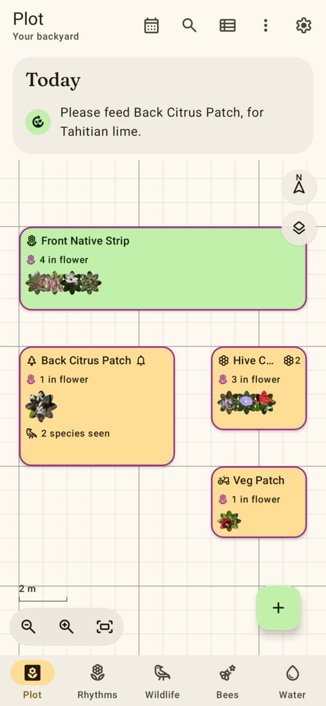
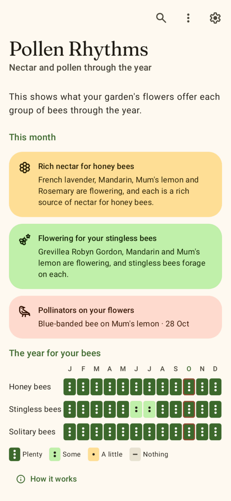
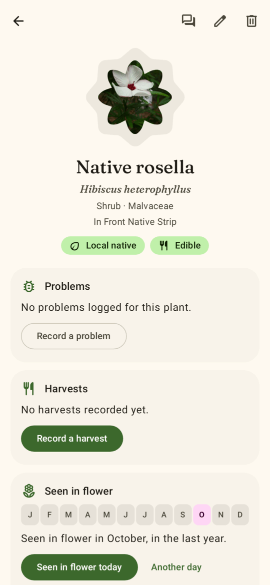
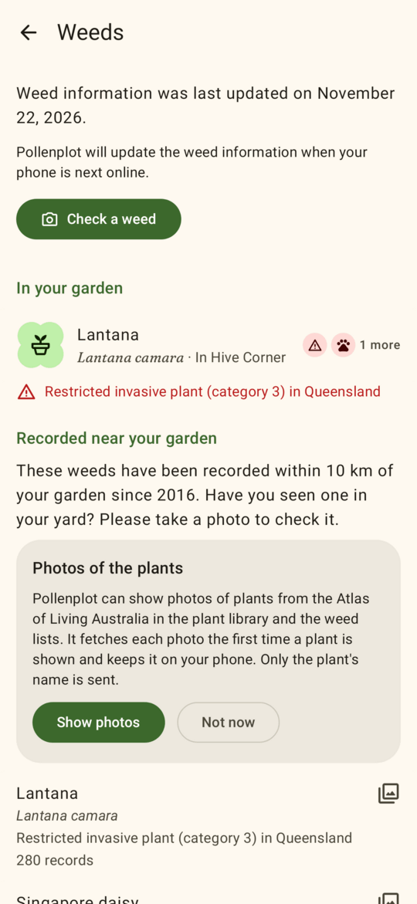
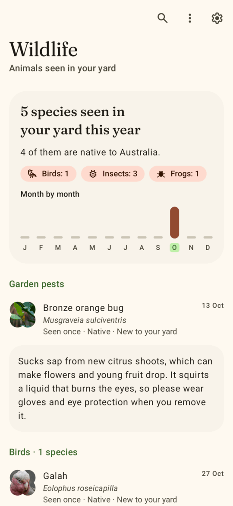
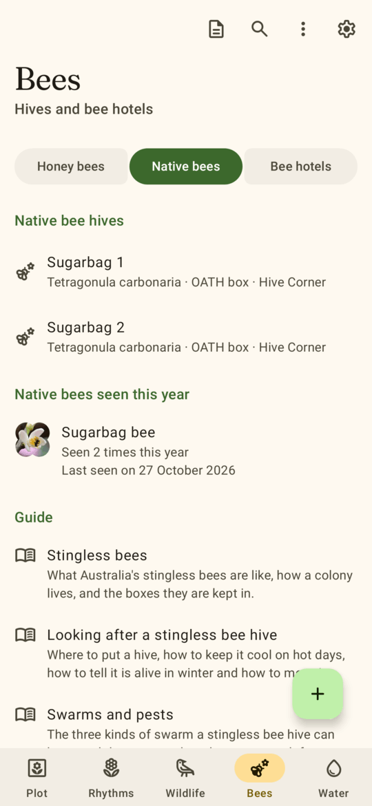
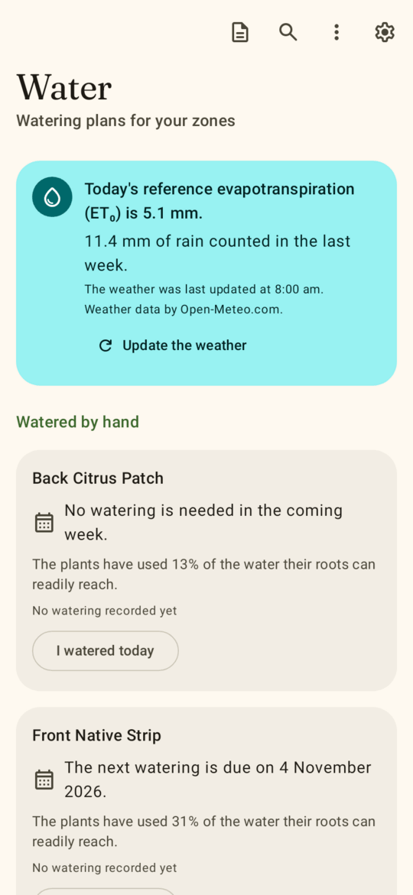
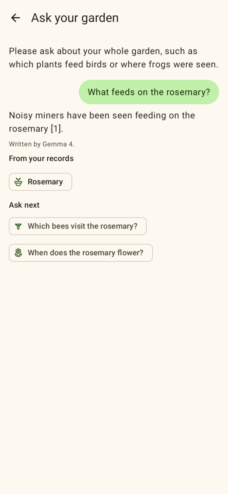

# Pollenplot

Ecosystem Management for Your Backyard.

Pollenplot is an Android app that helps you understand your backyard as an ecosystem. It identifies the plants and
animals in your garden from a photo, keeps a record of your zones, plants, wildlife, bees and watering, and shows you
how they all fit together. Your photos are identified on your phone and never leave it. The app is written for Australian
gardens, with Australian native plants, Southern Hemisphere seasons and each state's rules.

<p align="center">
  
  
  
</p>

Pollenplot requires Android 12 or newer, and you can download test versions from the
[Releases page](https://github.com/w-koller/Pollenplot/releases), each with its SHA-256 checksum.

## What it does

### See your whole yard at a glance

The Plot is a map of your yard, divided into zones such as a front native strip, a citrus patch or a hive corner. Each
plant appears as a cut-out from your own photo, so you can see what is growing where and which zones are in flower.
The Today card lists the jobs due in the garden, such as feeding the citrus or checking a hive, and the calendar shows
the jobs ahead alongside the weather.

### Identify plants and animals

Take a photo of a plant or an animal, or choose one from your gallery, and Pollenplot will suggest what it is and how
sure it is. A photo of a garden bed can show several plants, and the app will find each one. You can download the
accurate identification pack to recognise many more Australian plants, animals and fungi. The app also learns from
your corrections, so a name you keep changing will give way to yours.

### Know what each plant needs

<p align="center">
  
  
</p>

Each plant has its own page with its sun, water, soil, feeding and compost needs, its value to wildlife and the
companion plants that suit it. You can correct any of these if your garden is different. The page also keeps the
plant's photos, the months it was seen in flower, its harvests and its pruning, and a potted plant will tell you when it
is due a flush or a repot.

You can also keep track of:

- feeding, with a warning before too much phosphorus goes on grevilleas and their relatives, and a reminder when
  your citrus is due a feed;
- pests and diseases, recorded with a photo and their treatments, and a warning before you spray plants that are in
  flower;
- harvests by season, and when to prune each plant;
- compost bins, with the turns and checks each batch is due;
- a wishlist of plants you would like to grow, including plants you identify away from home, with whether each is
  native or a weed where you live;
- a library of every plant you have grown.

### Keep weeds out of your garden

Your plants are checked against the official weed lists for your area, from Brisbane City Council, Weeds
Australia and the Atlas of Living Australia. You can also see the weeds that have been recorded near your garden, and
native plants to grow instead from the Grow Me Instead booklets.

### Get to know your wildlife

<p align="center">
  
  
</p>

The Wildlife tab shows every animal seen in your yard over the year, which of them are native and which were seen for
the first time. If an animal is venomous, or your state asks you to report it, the app tells you what to do and links
to the official page.

Each zone also shows its habitat for wildlife: its canopy, midstorey and understorey, its shelter on the ground and its
water, along with how well your whole yard works as a wildlife corridor.

### Look after your bees

The Bees tab has separate records and guides for European honey bees, Australian stingless bees and bee hotels.
You will be reminded when each honey bee hive is due an inspection, a brood check or a mite check under the
Australian Honey Bee Industry Biosecurity Code of Practice, and warned before a hot day that could harm your
stingless bee hives.

Pollen Rhythms shows what your garden's flowers offer honey bees, stingless bees and solitary bees through the year,
the months when there is little for each group, and plants that would fill those gaps.

### Water at the right time

<p align="center">
  
  
</p>

The Water tab works out when each zone needs watering, and how much, from its plants, its soil and the weather
forecast. It will warn you if a sprinkler waters faster than your soil can soak it up, and remind you to water your pots
deeply before a very hot day.

### Ask your garden

You can ask questions about your garden, such as which plants feed birds or where frogs have been seen,
once you have downloaded Gemma 4. Each answer is drawn from your own records, which are listed beneath it, along with
suggestions for what to ask next.

### Search, reports and backups

You can search all of your records from any tab, including the notes from your hive inspections, sightings and
harvests. Reports can be saved as PDF or Excel files, starting with a summary of your garden and the tasks that are
due. A backup saves your whole garden, including its photos, to a single file that you can protect with a password.

## Privacy

Photos are identified on the phone and never leave it, except in a backup file you save yourself. The app has no
account, no analytics and no advertising. It goes online only for:

- the weather forecast, from Open-Meteo;
- weed lists and plants and animals recorded near the garden, from Brisbane City Council and the Atlas of Living
  Australia;
- suburb search and the council area, from Open-Meteo and the Atlas of Living Australia;
- photos of plants for the plant library and the weed lists, from the Atlas of Living Australia, when you choose
  to show photos (only the plant's name is sent);
- the optional models, when you choose to download them.

The garden's location is rounded to about 1 km before it is sent to any of these.

## Permissions

- Camera, to identify a plant or animal in front of you. Photos you add from the gallery come through the system
  photo picker and need no permission.
- Photos and videos, only when you turn on gallery scanning in Settings, so new garden photos are looked at in the
  background. You can allow all photos or only the ones you choose.
- Approximate location, only when you ask the app to find the garden from where you are.
- Notifications, for hive checks, hot days ahead of stingless bee hives, watering due and finished scans.
- Internet, for the services listed under Privacy.

## Optional downloads

The quick identification models come with the app. The following are downloaded only when you ask for them, and each
file is checked against its published SHA-256 checksum:

- the accurate identification pack (BioCAP), about 142 MB, for better identification of plants, animals and fungi;
- the text model (bge-small-en-v1.5), about 34 MB, for search by meaning;
- Gemma 4 E2B, about 2.6 GB, for second opinions on unsure finds and for answering questions about your garden.

## Known limits

- The knowledge base is written for Australia. Months follow the garden's hemisphere, but the plants, weed sources and
  state rules are Australian.
- Weed lists for a council come from Brisbane City Council's open data. Elsewhere the app uses the national lists and
  links to the state's pages.
- Phone makers' battery savers can delay background scans and the morning reminders. Settings explains how to check
  this on your phone.
- Identification can be wrong. Please never eat a plant or handle an animal because the app named it.

## Building

```bash
export JAVA_HOME=/path/to/jdk-17 ANDROID_HOME=/path/to/android-sdk
./gradlew :domain:test :ml:test :app:testDebugUnitTest :app:assembleDebug
```

The debug APK is written to `app/build/outputs/apk/debug/`. It is a separate app from the release, with its own
records, so it is for testing only.

## Releases

Signed APKs are built by GitHub Actions and published as GitHub Releases, each with its SHA-256 checksum. To publish
one, set `versionCode` and `versionName` in `app/build.gradle.kts`, give the version a section headed `## <version>`
in `CHANGELOG.md`, merge it into `main` and push a tag such as `v1.0.0`. A version with a suffix, such as
`1.0.0-rc.1` and the tag `v1.0.0-rc.1`, is published as a pre-release for testing, which does not become the latest
release.

The release signing key is kept outside the repository and reaches CI as four repository secrets: `KEYSTORE_BASE64`,
`KEYSTORE_PASSWORD`, `KEY_ALIAS` and `KEY_PASSWORD`. Please keep a backup of the key, because without it a new version
cannot be installed over the old one.

## Licence

Pollenplot is released under the GNU General Public License, version 3. The models and data it uses keep their own
licences, which are listed in the app under About › Licences and About › Data sources.
