# Pollenplot

Ecosystem Management for Your Backyard.

<p align="center">
  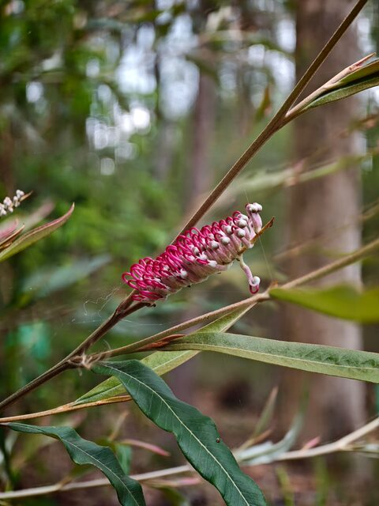
  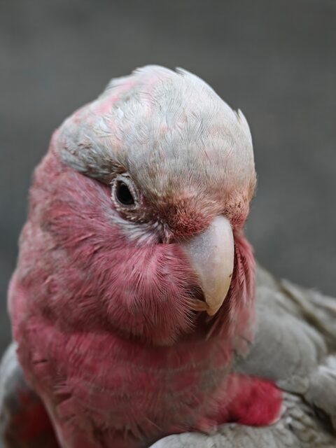
  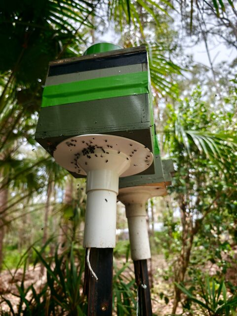
  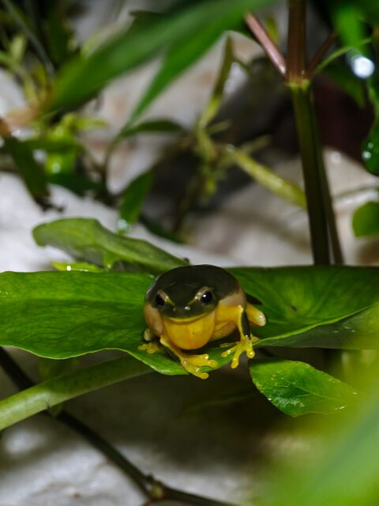
</p>

Pollenplot is an Android app for keeping a record of a backyard garden and seeing how it works as a whole. It
identifies plants and animals on the phone, so your photos never leave it, and it shows how the garden's plants,
wildlife, bees and watering fit together. It is written for Australian gardens first.

<p align="center">
  
  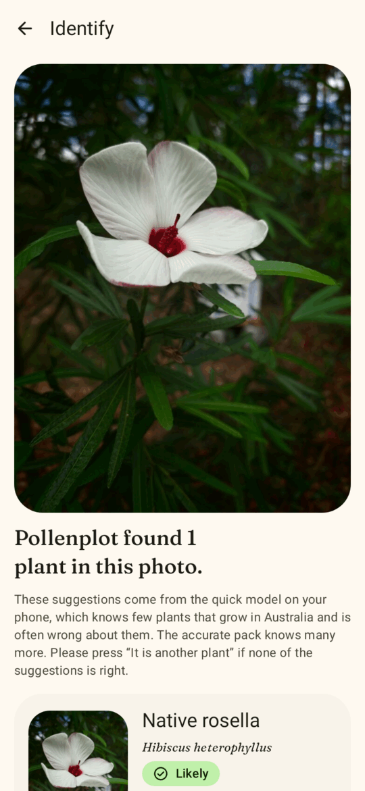
  
</p>

Pollenplot needs Android 12 or newer. Test versions are published on the
[Releases page](https://github.com/w-koller/Pollenplot/releases) with their SHA-256 checksums.

## What it does

### Your yard on one screen

The Plot is a map of your yard's zones, such as a front native strip, a citrus patch or a hive corner. Each plant
shows as its own cut-out photo, with badges for its role: pollinator magnet, high thirst or frog safe, for example. Layers
colour the zones by sun and shade, or by what is in flower now and what flowers next. A Today card at the top says
what needs doing, gathered from every part of the garden, and the calendar lays the same jobs out by day with the
weather.

### Identification on the phone

Point the camera at a plant or an animal, or add photos from your gallery. Pollenplot finds each plant in a photo of a
garden bed and suggests a name for each, with how sure it is. It can also look through new garden photos in the
background. The quick models come with the app, and an accurate pack (BioCAP) can be downloaded for many more
Australian plants, animals and fungi. Your own corrections teach it: a name you keep changing gives way to yours.

<p align="center">
  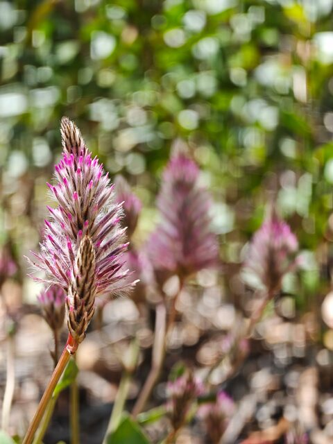
  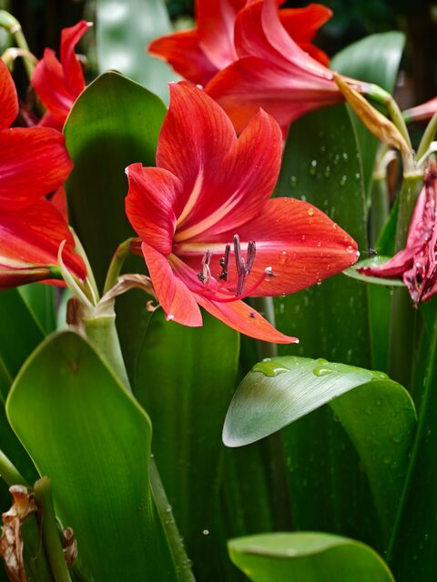
  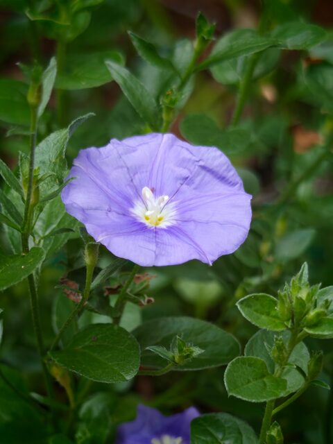
  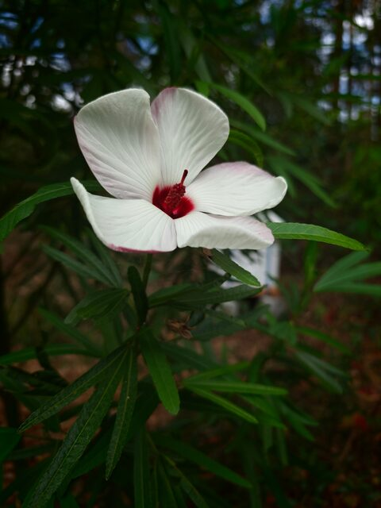
</p>

### Every plant's needs

<p align="center">
  
  
</p>

Each plant has a page with its sun, water, soil, feeding, compost and wildlife value, and the companion plants that
suit it. You can correct any of these facts for your own garden. The page also keeps the photos the plant was found
in, the months it was seen in flower, its harvests and its pruning. A potted plant says when its pot is due a flush or
a look at repotting.

Other records follow from the plants:

- feeding, with a warning before too much phosphorus goes on grevilleas and their relatives, and reminders when
  citrus is due a feed;
- pests and diseases, logged with a photo and their treatments, with a warning before spraying plants in flower;
- harvests by season, and when to prune each plant;
- compost bins, with the turns and checks each batch is due;
- a wishlist of plants to grow, including plants identified away from home, with whether each is native or a weed
  where you live;
- a plant library of everything you have grown.

<p align="center">
  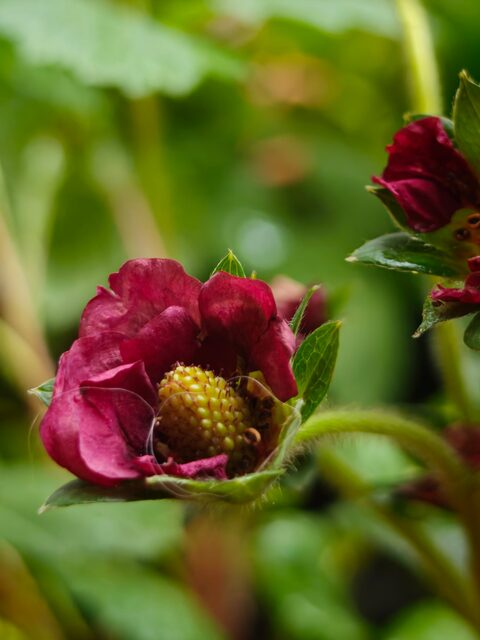
  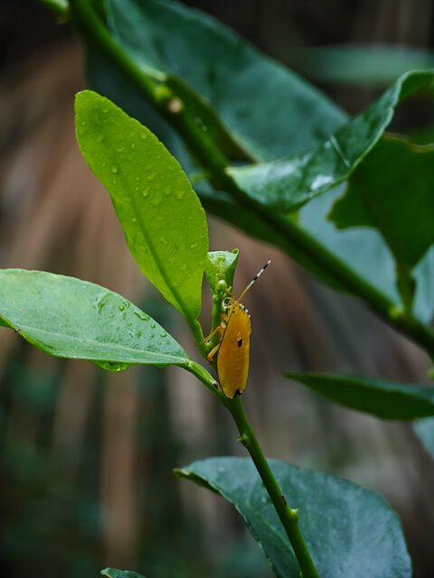
</p>

### Weeds checked against official lists

The weed identifier checks a plant against official sources for your area: Brisbane City Council, Weeds Australia and
the Atlas of Living Australia. It lists the weeds recorded near your garden and suggests native alternatives from the
Grow Me Instead booklets.

### Wildlife and bees

<p align="center">
  
  
</p>

The Wildlife tab shows a year of animals seen in your yard: which are native, which were new this year, and when each
was seen. It warns about animals that are venomous or that your state's law asks you to report, with a link to the
official page.

<p align="center">
  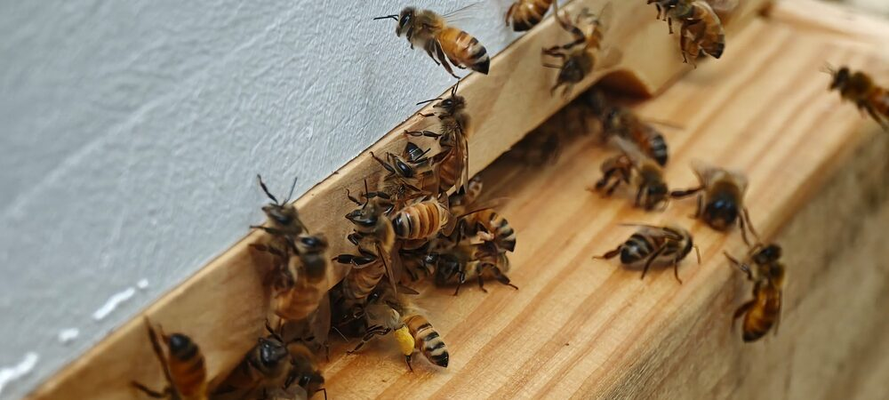
</p>

Bees get their own tab, with separate trackers for European honey bees, Australian stingless bees and bee hotels.
Honey bee hives are due inspections, brood checks and mite checks on the schedule of the Australian Honey Bee Industry
Biosecurity Code of Practice. Stingless bee hives get a warning before a hot day. Each section has guides, written from
the sources listed on each page.

Pollen Rhythms is a nectar and pollen calendar for honey bees, stingless bees and solitary bees. It shows the months
your garden has little to offer each group, and plants that would fill those gaps.

<p align="center">
  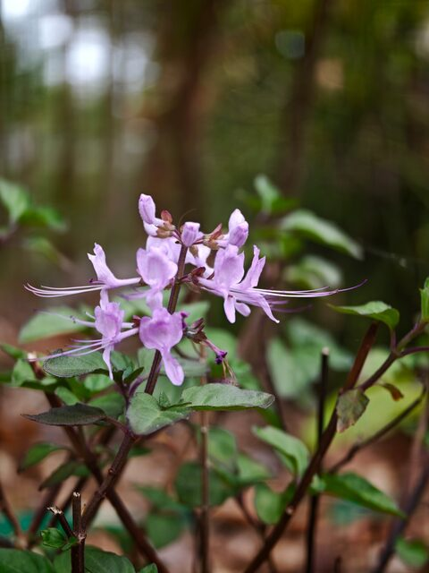
  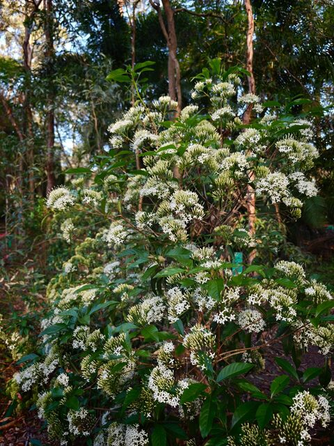
</p>

Each zone also has a habitat summary: its canopy, midstorey and understorey, the shelter on the ground and the water
for wildlife, and how the whole yard works as a wildlife corridor.

### Watering from the weather

<p align="center">
  
  
</p>

The Water tab keeps a daily soil-water account for each zone from its plants, its soil and the weather forecast, and
says when a watering is due and how much. It warns when a sprinkler runs faster than the soil can soak it up, and
reminds you to water pots deeply before a very hot day.

### Ask your garden

With Gemma 4 downloaded, you can ask questions about your garden, such as which plants feed birds or where frogs were
seen. The answers come from your own records, which are listed under each answer, and the app suggests what to ask
next.

### Search and reports

Search works from every tab across zones, plants, sightings, hives, hotels, the wishlist, problems and water for
wildlife, including the notes in your records. It searches by words, and by meaning once the optional text model is
on the phone. Reports come as PDF or Excel files, opening with a summary and the tasks due. A backup saves the whole
garden, with its photos, to one file that can be locked with a password.

The photos are real garden photos. The screenshots come from the app's screen tests, which run on a demo yard.

## Privacy

Photos are identified on the phone and never leave it, except in a backup file you save yourself. The app has no
account, no analytics and no advertising. It goes online only for:

- the weather forecast, from Open-Meteo;
- weed lists and plants and animals recorded near the garden, from Brisbane City Council and the Atlas of Living
  Australia;
- suburb search and the council area, from Open-Meteo and the Atlas of Living Australia;
- photos of plants for the plant library and the weed lists, from the Atlas of Living Australia, when you choose
  to show photos (only the plant's name is sent);
- the optional models, when you choose to download them.

The garden's location is rounded to about 1 km before it is sent to any of these.

## Permissions

- Camera, to identify a plant or animal in front of you. Photos you add from the gallery come through the system
  photo picker and need no permission.
- Photos and videos, only when you turn on gallery scanning in Settings, so new garden photos are looked at in the
  background. You can allow all photos or only the ones you choose.
- Approximate location, only when you ask the app to find the garden from where you are.
- Notifications, for hive checks, hot days ahead of stingless bee hives, watering due and finished scans.
- Internet, for the services listed under Privacy.

## Optional downloads

The quick identification models come with the app. These are downloaded only when you ask for them, and each file is
checked against its published SHA-256 checksum:

- the accurate identification pack (BioCAP), about 142 MB, for better identification of plants, animals and fungi;
- the text model (bge-small-en-v1.5), about 34 MB, for search by meaning;
- Gemma 4 E2B, about 2.6 GB, for second opinions on unsure finds and for answering questions about your garden.

## Known limits

- The knowledge base is written for Australia. Months follow the garden's hemisphere, but the plants, weed sources and
  state rules are Australian.
- Weed lists for a council come from Brisbane City Council's open data. Elsewhere the app uses the national lists and
  links to the state's pages.
- Phone makers' battery savers can delay background scans and the morning reminders. Settings explains how to check
  this on your phone.
- Identification can be wrong. Please never eat a plant or handle an animal because the app named it.

## Building

```bash
export JAVA_HOME=/path/to/jdk-17 ANDROID_HOME=/path/to/android-sdk
./gradlew :domain:test :ml:test :app:testDebugUnitTest :app:assembleDebug
```

The debug APK is written to `app/build/outputs/apk/debug/`. It is a separate app from the release, with its own
records, so it is for testing only.

## Releases

Signed APKs are built by GitHub Actions and published as GitHub Releases, each with its SHA-256 checksum. To publish
one, set `versionCode` and `versionName` in `app/build.gradle.kts`, give the version a section headed `## <version>`
in `CHANGELOG.md`, merge it into `main` and push a tag such as `v1.0.0`. A version with a suffix, such as
`1.0.0-rc.1` and the tag `v1.0.0-rc.1`, is published as a pre-release for testing, which does not become the latest
release.

The release signing key is kept outside the repository and reaches CI as four repository secrets: `KEYSTORE_BASE64`,
`KEYSTORE_PASSWORD`, `KEY_ALIAS` and `KEY_PASSWORD`. Please keep a backup of the key, because without it a new version
cannot be installed over the old one.

## Licence

Pollenplot is released under the GNU General Public License, version 3. The models and data it uses keep their own
licences, which are listed in the app under About › Licences and About › Data sources.
